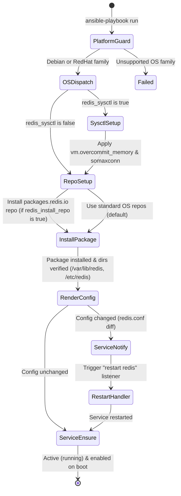

# Data Model: Redis Open Source Role (`redis`)

**Feature**: `006-redis-role`  
**Date**: 2026-11-09

## Entities

### 1. Redis Role Variables (`redis_*` variables in `roles/redis/defaults/main.yml`)

Represents the user-tunable input variables that control package installation, service lifecycle, password authentication, network bindings, memory caps, persistence, and optional kernel parameters.

| Variable | Type | Default | Required | Validation / Description |
|---|---|---|---|---|
| `redis_install_repo` | `boolean` | `false` | No | When `true`, configures the official `packages.redis.io` upstream package repository before installation |
| `redis_package_state` | `string` | `"present"` | Yes | Desired package state (`"present"`, `"latest"`) |
| `redis_service_enabled` | `boolean` | `true` | Yes | Whether the Redis service is enabled at boot |
| `redis_service_state` | `string` | `"started"` | Yes | Desired state of the Redis service (`"started"`, `"stopped"`) |
| `redis_bind` | `string \| list[string]` | `"127.0.0.1 -::1"` | Yes | IP addresses/interfaces Redis binds to |
| `redis_port` | `integer` | `6379` | Yes | TCP port number (`1..65535`) |
| `redis_protected_mode` | `boolean` | `true` | Yes | Enables protected mode when binding to all interfaces without authentication |
| `redis_password` | `string` | `""` | No | Secret string for `requirepass`. When non-empty, sets password authentication; when empty, disabled |
| `redis_no_log` | `boolean` | `true` | No | Suppresses task logging and diff output when `redis_password` is set to prevent credential leaks |
| `redis_tcp_backlog` | `integer` | `511` | Yes | TCP listen backlog |
| `redis_timeout` | `integer` | `0` | Yes | Close connection after client is idle for N seconds (`0` disables timeout) |
| `redis_tcp_keepalive` | `integer` | `300` | Yes | TCP keepalive interval in seconds |
| `redis_databases` | `integer` | `16` | Yes | Number of databases |
| `redis_loglevel` | `string` | `"notice"` | Yes | Log verbosity: `debug`, `verbose`, `notice`, `warning` |
| `redis_logfile` | `string` | `""` | No | Path to log file; when empty `""`, defaults to OS-appropriate path |
| `redis_dir` | `string` | `"/var/lib/redis"` | Yes | Working directory for DB persistence files |
| `redis_save` | `list[string]` | `["3600 1", "300 100", "60 10000"]` | No | List of RDB snapshot save points (`seconds changes`). Empty list `[]` disables snapshots |
| `redis_appendonly` | `boolean` | `false` | Yes | Enable AOF (Append-Only File) persistence |
| `redis_maxmemory` | `string` | `""` | No | Memory usage limit (e.g., `"256mb"`, `"2gb"`). Unset if empty |
| `redis_maxmemory_policy` | `string` | `"noeviction"` | Yes | Eviction policy: `noeviction`, `allkeys-lru`, `volatile-lru`, `allkeys-lfu`, etc. |
| `redis_extra_config` | `dict \| list` | `{}` | No | Arbitrary raw `redis.conf` directives for advanced settings |
| `redis_sysctl` | `boolean` | `false` | No | When `true`, configures recommended `vm.overcommit_memory = 1` and `net.core.somaxconn = 512` |

---

### 2. OS-Specific Variables Contract (`roles/redis/vars/<ansible_os_family>.yml`)

Represents distribution-specific package, service, and filesystem attributes isolated in OS variable files.

| Attribute / Field | Debian Family (`vars/Debian.yml`) | RedHat Family (`vars/RedHat.yml`) | Description |
|---|---|---|---|
| `redis_package_name` | `redis-server` | `redis` | Distribution package name |
| `redis_service_name` | `redis-server` | `redis` | Systemd service name |
| `redis_config_dir` | `/etc/redis` | `/etc/redis` | Configuration directory path |
| `redis_config_file` | `/etc/redis/redis.conf` | `/etc/redis/redis.conf` | Primary configuration file path |
| `redis_default_logfile` | `/var/log/redis/redis-server.log` | `/var/log/redis/redis.log` | Default log file path |
| `redis_system_user` | `redis` | `redis` | System service user |
| `redis_system_group` | `redis` | `redis` | System service group |
| `redis_config_owner` | `root` | `redis` | File owner of `redis.conf` |
| `redis_config_group` | `redis` | `redis` | File group of `redis.conf` |
| `redis_config_mode` | `'0640'` | `'0640'` | Permissions mode of `redis.conf` |

---

### 3. Redis Runtime Configuration File (`redis.conf`)

Represents the rendered Jinja2 template file deployed to `{{ redis_config_file }}`.

| Directive | Rendered Value | Description |
|---|---|---|
| `bind` | `{{ redis_bind }}` | Bound socket IP addresses |
| `port` | `{{ redis_port }}` | Listening port |
| `protected-mode` | `yes` / `no` | Derived from `redis_protected_mode` |
| `requirepass` | `"..."` | Quoted password when `redis_password \| length > 0`; omitted when empty |
| `supervised` | `systemd` | Tells Redis to signal systemd when ready |
| `daemonize` | `no` | Prevents forking when under systemd |
| `dir` | `{{ redis_dir }}` | Working directory for RDB/AOF files |
| `save` | `save <seconds> <changes>` | Rendered for each entry in `redis_save` |
| `appendonly` | `yes` / `no` | Derived from `redis_appendonly` |
| `maxmemory` | `{{ redis_maxmemory }}` | Rendered when `redis_maxmemory \| length > 0` |
| `maxmemory-policy` | `{{ redis_maxmemory_policy }}` | Eviction policy |

---

## Lifecycle State Transitions

### Detailed Transitions:
1. **Initial Provisioning (Clean Host)**:
   - Platform guard verifies `ansible_os_family in ['Debian', 'RedHat']`.
   - `vars/{{ ansible_os_family }}.yml` is loaded.
   - If `redis_sysctl: true`, apply kernel parameters.
   - If `redis_install_repo: true`, import GPG key and add upstream repository.
   - Install `redis_package_name`.
   - Ensure `/var/lib/redis` and `/var/log/redis` exist with `0750` / `redis:redis`.
   - Render `redis.conf.j2` with mode `'0640'`.
   - Enable and start `redis_service_name`.
2. **Password Configuration Change**:
   - Operator updates `redis_password` from `""` to `"SecretPass123"` (or rotates it).
   - Template task detects diff, sets `no_log: "{{ redis_no_log }}"`, writes `requirepass "SecretPass123"`, and notifies `restart redis`.
   - Handler runs `ansible.builtin.service: name={{ redis_service_name }} state=restarted`.
   - Redis enforces authentication on all subsequent connections.
3. **Idempotent Re-Run**:
   - Variables unchanged.
   - Package state already present.
   - File template matches on-disk contents; no diff generated; handler not notified.
   - Service state verified running.
   - Playbook completes with `changed=0`.
