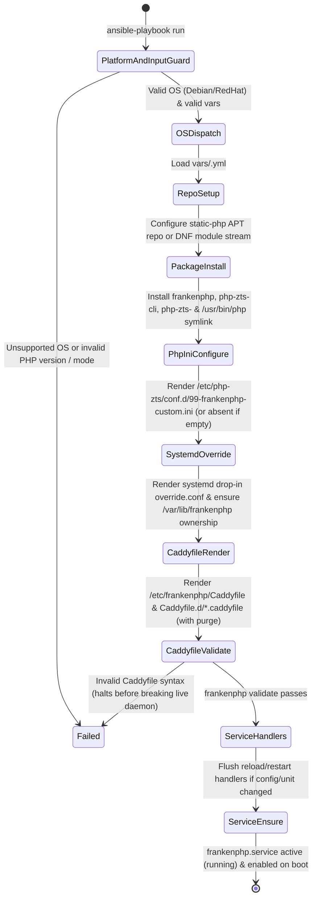

# Data Model: FrankenPHP Application Server Role (`frankenphp`)

**Feature**: `007-frankenphp-role`  
**Date**: 2026-11-09

## Entities

### 1. FrankenPHP Role Variables (`frankenphp_*` variables in `roles/frankenphp/defaults/main.yml`)

Represents the user-tunable input variables that control repository setup, PHP version & extensions, custom `php.ini` tuning, daemon mode (`"caddyfile"` vs `"octane"`), custom `Caddyfile` and `Caddyfile.d` snippets, systemd user/group/environment overrides, and service state.

| Variable | Type | Default | Required | Validation / Description |
|---|---|---|---|---|
| `frankenphp_php_version` | `string` | `"8.4"` | Yes | Target ZTS PHP major.minor branch (`"8.2"`, `"8.3"`, `"8.4"`, `"8.5"`). Validated via `assert`. |
| `frankenphp_package_state` | `string` | `"present"` | Yes | Desired package state (`"present"`, `"latest"`). |
| `frankenphp_install_php_cli` | `boolean` | `true` | Yes | When `true`, installs `php-zts-cli` alongside `frankenphp`. |
| `frankenphp_manage_php_symlink` | `boolean` | `true` | Yes | When `true` and `frankenphp_install_php_cli` is `true`, creates `/usr/bin/php -> /usr/bin/php-zts` symlink (`force: false`). |
| `frankenphp_install_pie` | `boolean` | `false` | No | When `true`, installs `pie-zts` (PHP Installer for Extensions). |
| `frankenphp_php_extensions` | `list[string]` | `['bcmath', 'curl', 'gd', 'intl', 'mbstring', 'mysql', 'opcache', 'pcntl', 'pdo', 'redis', 'sqlite3', 'xml', 'zip']` | No | List of PHP extensions to ensure are available. Extensions built into `php-zts-cli` (`curl`, `mbstring`, `opcache`, `pcntl`, `xml`, etc.) are automatically satisfied; separate `php-zts-<ext>` packages are installed using OS-normalized mappings. |
| `frankenphp_php_ini` | `dict[string, string \| int \| bool]` | `{}` | No | Dictionary of custom `php.ini` directives rendered to `/etc/php-zts/conf.d/99-frankenphp-custom.ini`. |
| `frankenphp_daemon_mode` | `string` | `"caddyfile"` | Yes | Daemon execution mode: `"caddyfile"` (`frankenphp run --environ --config ...`) or `"octane"` (`php-zts artisan octane:frankenphp ...`). |
| `frankenphp_config_dir` | `string` | `"/etc/frankenphp"` | Yes | Main FrankenPHP configuration directory. |
| `frankenphp_caddyfile_path` | `string` | `"/etc/frankenphp/Caddyfile"` | Yes | Path to the primary rendered `Caddyfile`. |
| `frankenphp_caddyfile` | `string` | Baseline multi-line Caddyfile | Yes | Complete raw multi-line `Caddyfile` content rendered to `frankenphp_caddyfile_path`. Supports worker mode (e.g., Laravel Octane worker script) or classic `php_server`. |
| `frankenphp_caddyfile_d` | `list[dict]` | `[]` | No | List of drop-in Caddyfile snippet dicts `{ name: string, content: string }` rendered to `{{ frankenphp_config_dir }}/Caddyfile.d/{{ item.name }}.caddyfile`. |
| `frankenphp_caddyfile_d_purge` | `boolean` | `true` | No | When `true`, removes unmanaged `*.caddyfile` files in `{{ frankenphp_config_dir }}/Caddyfile.d/`. |
| `frankenphp_octane_app_dir` | `string` | `"/var/www/html"` | Conditional | Path to the Laravel application root containing `artisan` (used when `frankenphp_daemon_mode == "octane"`). |
| `frankenphp_octane_host` | `string` | `"127.0.0.1"` | Conditional | Bind IP address for `octane:frankenphp` (`--host`). |
| `frankenphp_octane_port` | `integer` | `8000` | Conditional | Listening TCP port for `octane:frankenphp` (`--port`, `1..65535`). |
| `frankenphp_octane_admin_port` | `integer` | `2019` | Conditional | Caddy admin TCP port for `octane:frankenphp` (`--admin-port`, `1..65535`). |
| `frankenphp_octane_workers` | `string \| int` | `"auto"` | Conditional | Worker thread count for `octane:frankenphp` (`--workers`). |
| `frankenphp_octane_max_requests` | `integer` | `500` | Conditional | Max requests per worker before restart (`--max-requests`). |
| `frankenphp_octane_use_custom_caddyfile` | `boolean` | `false` | Conditional | When `true` in `"octane"` mode, passes `--caddyfile={{ frankenphp_caddyfile_path }}` to `octane:frankenphp` and validates `frankenphp_caddyfile`. |
| `frankenphp_octane_extra_flags` | `list[string]` | `[]` | No | Extra CLI flags appended to `octane:frankenphp` (e.g., `["--https", "--http-redirect"]`). |
| `frankenphp_user` | `string` | `"frankenphp"` | Yes | System user under which `frankenphp.service` runs. |
| `frankenphp_group` | `string` | `"frankenphp"` | Yes | System group under which `frankenphp.service` runs. |
| `frankenphp_data_dir` | `string` | `"/var/lib/frankenphp"` | Yes | Working/data directory owned by `{{ frankenphp_user }}:{{ frankenphp_group }}` (`0750`). |
| `frankenphp_env` | `dict[string, string \| int]` | `{}` | No | Environment variables injected into `frankenphp.service` via systemd drop-in override. |
| `frankenphp_service_enabled` | `boolean` | `true` | Yes | Whether `frankenphp.service` is enabled at system boot. |
| `frankenphp_service_state` | `string` | `"started"` | Yes | Desired runtime state of `frankenphp.service` (`"started"`, `"stopped"`). |

---

### 2. OS-Specific Variables Contract (`roles/frankenphp/vars/<ansible_os_family>.yml`)

Represents distribution-specific repository configurations, package prerequisites, and extension name mappings isolated per OS family.

| Attribute / Field | Debian Family (`vars/Debian.yml`) | RedHat Family (`vars/RedHat.yml`) | Description |
|---|---|---|---|
| `frankenphp_pre_packages` | `['ca-certificates', 'curl', 'gnupg']` | `['ca-certificates', 'curl']` | Prerequisite packages for repository setup |
| `frankenphp_apt_key_url` | `https://pkg.henderkes.com/api/packages/{{ frankenphp_php_version \| replace('.', '') }}/debian/repository.key` | N/A | Upstream APT GPG key URL |
| `frankenphp_apt_key_path` | `/etc/apt/keyrings/static-php{{ frankenphp_php_version \| replace('.', '') }}.asc` | N/A | Keyring file path on Debian/Ubuntu |
| `frankenphp_apt_repo` | `deb [signed-by=...] https://pkg.henderkes.com/api/packages/{{ frankenphp_php_version \| replace('.', '') }}/debian php-zts main` | N/A | APT source line |
| `frankenphp_rpm_repo_url` | N/A | `https://rpm.henderkes.com/static-php-1-1.noarch.rpm` | Static-PHP RPM repository release package |
| `frankenphp_dnf_module_stream` | N/A | `php-zts:static-{{ frankenphp_php_version }}` | DNF module stream for selected PHP version |
| `frankenphp_service_name` | `frankenphp` | `frankenphp` | Systemd service unit name |
| `frankenphp_php_ini_dir` | `/etc/php-zts/conf.d` | `/etc/php-zts/conf.d` | PHP ZTS additional INI scan directory |
| `frankenphp_extension_map` | `mysql: ['mysqlnd', 'mysqli', 'pdo-mysql']`, `pdo_mysql: ['pdo-mysql']`, `sqlite3: ['sqlite3', 'pdo-sqlite']`, `pdo_sqlite: ['pdo-sqlite']`, `pgsql: ['pgsql', 'pdo-pgsql']`, `pdo_pgsql: ['pdo-pgsql']` | `mysql: ['mysqlnd', 'mysqli', 'pdo_mysql']`, `pdo-mysql: ['pdo_mysql']`, `sqlite3: ['sqlite3', 'pdo_sqlite']`, `pdo-sqlite: ['pdo_sqlite']`, `pgsql: ['pgsql', 'pdo_pgsql']`, `pdo-pgsql: ['pdo_pgsql']` | Normalizes extension names to OS package suffixes |

---

### 3. Configuration & Service Files Managed on Target Host

| File Path | Owner / Group | Mode | Template / Source | Handler Triggered |
|---|---|---|---|---|
| `/etc/frankenphp/Caddyfile` | `root:{{ frankenphp_group }}` | `'0644'` | `templates/Caddyfile.j2` | `validate and reload frankenphp` |
| `/etc/frankenphp/Caddyfile.d/<name>.caddyfile` | `root:{{ frankenphp_group }}` | `'0644'` | `templates/caddyfile-d.j2` | `validate and reload frankenphp` |
| `/etc/php-zts/conf.d/99-frankenphp-custom.ini` | `root:root` | `'0644'` | `templates/99-frankenphp-custom.ini.j2` | `validate and restart frankenphp` |
| `/etc/systemd/system/frankenphp.service.d/override.conf` | `root:root` | `'0644'` | `templates/override.conf.j2` | `reload systemd and restart frankenphp` |
| `/var/lib/frankenphp` | `{{ frankenphp_user }}:{{ frankenphp_group }}` | `'0750'` | Directory (`ansible.builtin.file`) | `validate and restart frankenphp` |

---

## Lifecycle State Transitions

