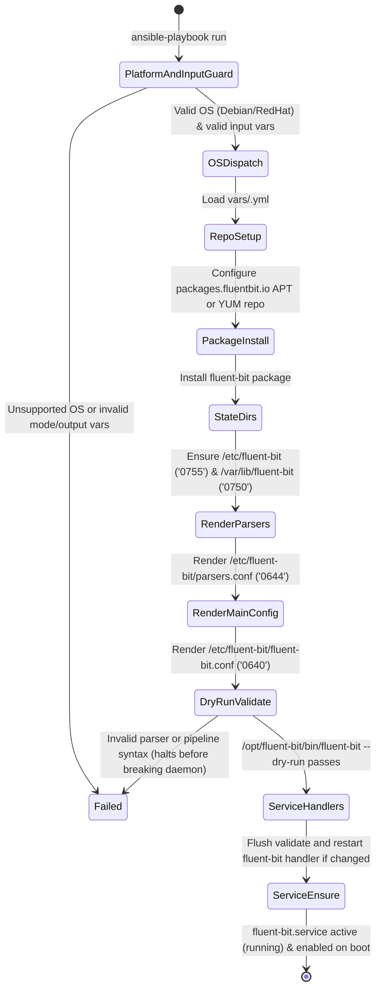

# Data Model: Fluent Bit Log Collector and Forwarder Role (`fluentbit`)

**Feature**: `008-fluentbit-role`  
**Date**: 2026-11-14

## Entities

### 1. Fluent Bit Role Variables (`fluentbit_*` variables in `roles/fluentbit/defaults/main.yml`)

Represents the user-tunable input variables that control package installation, daemon service settings, HTTP monitoring endpoint, Laravel multiline log parsing, Nginx access/error log parsing, host system log collection, Graylog (`gelf`) output, Grafana Loki (`loki`) output, and custom parser/input/filter/output extensions.

| Variable | Type | Default | Required | Validation / Description |
|---|---|---|---|---|
| `fluentbit_package_state` | `string` | `"present"` | Yes | Desired package state (`"present"`, `"latest"`). |
| `fluentbit_service_enabled` | `boolean` | `true` | Yes | Whether `fluent-bit.service` is enabled at system boot. |
| `fluentbit_service_state` | `string` | `"started"` | Yes | Desired runtime state of `fluent-bit.service` (`"started"`, `"stopped"`). |
| `fluentbit_config_dir` | `string` | `"/etc/fluent-bit"` | Yes | Main Fluent Bit configuration directory. |
| `fluentbit_storage_dir` | `string` | `"/var/lib/fluent-bit"` | Yes | Persistent directory for SQLite tail position databases (`mode: '0750'`). |
| `fluentbit_flush_interval` | `number` | `1` | Yes | `[SERVICE] Flush` interval in seconds (`> 0`). |
| `fluentbit_log_level` | `string` | `"info"` | Yes | `[SERVICE] Log_Level` (`"off"`, `"error"`, `"warning"`, `"info"`, `"debug"`, `"trace"`). |
| `fluentbit_http_server` | `boolean` | `false` | Yes | Enable built-in HTTP monitoring/metrics server (`[SERVICE] HTTP_Server`). |
| `fluentbit_http_listen` | `string` | `"127.0.0.1"` | Conditional | Bind address for built-in HTTP monitoring server (`[SERVICE] HTTP_Listen`). |
| `fluentbit_http_port` | `integer` | `2020` | Conditional | Listening TCP port for built-in HTTP server (`1..65535`). |
| `fluentbit_laravel_enabled` | `boolean` | `true` | Yes | Enable Laravel multiline log collection and parsing pipeline. |
| `fluentbit_laravel_log_paths` | `list[string]` | `["/var/www/*/storage/logs/*.log", "/var/log/laravel/*.log"]` | Conditional | Non-empty list of file path globs when `fluentbit_laravel_enabled: true`. |
| `fluentbit_laravel_tag` | `string` | `"laravel.app"` | Yes | Tag assigned to Laravel log records. |
| `fluentbit_laravel_mem_buf_limit` | `string` | `"10MB"` | Yes | `Mem_Buf_Limit` for the Laravel `tail` input. |
| `fluentbit_nginx_enabled` | `boolean` | `true` | Yes | Enable Nginx access and error log collection and parsing pipelines. |
| `fluentbit_nginx_access_log_paths` | `list[string]` | `["/var/log/nginx/*access*.log"]` | Conditional | Non-empty list of file path globs for Nginx access logs. |
| `fluentbit_nginx_error_log_paths` | `list[string]` | `["/var/log/nginx/*error*.log"]` | Conditional | Non-empty list of file path globs for Nginx error logs. |
| `fluentbit_nginx_access_tag` | `string` | `"nginx.access"` | Yes | Tag assigned to Nginx access log records. |
| `fluentbit_nginx_error_tag` | `string` | `"nginx.error"` | Yes | Tag assigned to Nginx error log records. |
| `fluentbit_system_log_enabled` | `boolean` | `true` | Yes | Enable host system log collection (`systemd` journal and/or `syslog` files). |
| `fluentbit_system_log_mode` | `string` | `"systemd"` | Yes | System log input mode: `"systemd"`, `"syslog"`, or `"both"`. |
| `fluentbit_system_log_paths` | `list[string]` | `[]` (defaults to `fluentbit_default_syslog_paths` per OS) | Optional | Override list of syslog file paths when `fluentbit_system_log_mode` is `"syslog"` or `"both"`. |
| `fluentbit_system_systemd_filters` | `list[string]` | `[]` | No | Optional list of `Systemd_Filter` unit expressions (e.g., `["_SYSTEMD_UNIT=sshd.service"]`). |
| `fluentbit_system_tag` | `string` | `"system.syslog"` | Yes | Tag assigned to system log records. |
| `fluentbit_extra_parsers` | `list[dict]` | `[]` | No | Additional custom `[PARSER]` or `[MULTILINE_PARSER]` definitions appended to `parsers.conf`. |
| `fluentbit_extra_inputs` | `list[dict]` | `[]` | No | Additional custom `[INPUT]` block dictionaries rendered into `fluent-bit.conf`. |
| `fluentbit_extra_filters` | `list[dict]` | `[]` | No | Additional custom `[FILTER]` block dictionaries rendered into `fluent-bit.conf`. |
| `fluentbit_graylog_enabled` | `boolean` | `false` | Yes | Enable forwarding logs to Graylog via `gelf` output plugin. |
| `fluentbit_graylog_host` | `string` | `"127.0.0.1"` | Conditional | Non-empty Graylog target hostname or IP when `fluentbit_graylog_enabled: true`. |
| `fluentbit_graylog_port` | `integer` | `12201` | Conditional | Graylog GELF port (`1..65535`). |
| `fluentbit_graylog_mode` | `string` | `"udp"` | Conditional | GELF transport protocol: `"udp"`, `"tcp"`, or `"tls"`. |
| `fluentbit_graylog_match` | `string` | `"*"` | Yes | Tag match pattern for Graylog output. |
| `fluentbit_graylog_tls_verify` | `boolean` | `true` | No | Verify Graylog TLS certificate when `fluentbit_graylog_mode == "tls"`. |
| `fluentbit_graylog_extra_options` | `dict[string, string \| int \| bool]` | `{}` | No | Extra key-value directives for the Graylog `gelf` `[OUTPUT]` block. |
| `fluentbit_loki_enabled` | `boolean` | `false` | Yes | Enable forwarding logs to Grafana Loki via `loki` output plugin. |
| `fluentbit_loki_host` | `string` | `"127.0.0.1"` | Conditional | Non-empty Loki target hostname or IP when `fluentbit_loki_enabled: true`. |
| `fluentbit_loki_port` | `integer` | `3100` | Conditional | Loki HTTP/HTTPS port (`1..65535`). |
| `fluentbit_loki_uri` | `string` | `"/loki/api/v1/push"` | Yes | Loki push API URI path. |
| `fluentbit_loki_match` | `string` | `"*"` | Yes | Tag match pattern for Loki output. |
| `fluentbit_loki_tls` | `boolean` | `false` | Yes | Enable HTTPS/TLS for Loki output (`On`/`Off`). |
| `fluentbit_loki_tls_verify` | `boolean` | `true` | Yes | Verify Loki TLS certificate (`On`/`Off`). |
| `fluentbit_loki_tenant_id` | `string` | `""` | No | Optional `tenant_id` (`X-Scope-OrgID`) for multi-tenant Loki. |
| `fluentbit_loki_http_user` | `string` | `""` | No | Optional HTTP Basic Auth username for Loki. |
| `fluentbit_loki_http_passwd` | `string` | `""` | No | Optional HTTP Basic Auth password/token for Loki. |
| `fluentbit_loki_bearer_token` | `string` | `""` | No | Optional HTTP Bearer token for Loki. |
| `fluentbit_loki_labels` | `list[string]` | `["job=fluentbit", "host=$hostname", "source=$log_source", "level=$level"]` | Yes | Stream label mappings for Loki output. |
| `fluentbit_loki_line_format` | `string` | `"json"` | Yes | Loki log line format (`"json"` or `"key_value"`). |
| `fluentbit_loki_extra_options` | `dict[string, string \| int \| bool]` | `{}` | No | Extra key-value directives for the `loki` `[OUTPUT]` block. |
| `fluentbit_stdout_enabled` | `boolean` | `false` | No | Enable `[OUTPUT] Name stdout` (`Match *`) for debugging/local inspection. |
| `fluentbit_extra_outputs` | `list[dict]` | `[]` | No | Additional custom `[OUTPUT]` block dictionaries rendered into `fluent-bit.conf`. |

---

### 2. OS-Specific Variables Contract (`roles/fluentbit/vars/<ansible_os_family>.yml`)

Represents distribution-specific repository configurations, package names, binary paths, and default syslog paths isolated per OS family.

| Attribute / Field | Debian Family (`vars/Debian.yml`) | RedHat Family (`vars/RedHat.yml`) | Description |
|---|---|---|---|
| `fluentbit_pre_packages` | `['ca-certificates', 'curl', 'gnupg']` | `['ca-certificates']` | Prerequisite packages for repository setup |
| `fluentbit_gpg_key_url` | `https://packages.fluentbit.io/fluentbit.key` | `https://packages.fluentbit.io/fluentbit.key` | Official Fluent Bit GPG signing key URL |
| `fluentbit_apt_key_path` | `/etc/apt/keyrings/fluentbit.asc` | N/A | Keyring file path on Debian/Ubuntu |
| `fluentbit_apt_repo` | `deb [signed-by=/etc/apt/keyrings/fluentbit.asc] https://packages.fluentbit.io/{{ ansible_facts['distribution'] \| lower }}/{{ ansible_facts['distribution_release'] }} {{ ansible_facts['distribution_release'] }} main` | N/A | APT source line |
| `fluentbit_yum_baseurl` | N/A | `https://packages.fluentbit.io/centos/$releasever/` | YUM/DNF repository baseurl for EL 8 & EL 9 |
| `fluentbit_package_name` | `fluent-bit` | `fluent-bit` | Upstream OS package name |
| `fluentbit_service_name` | `fluent-bit` | `fluent-bit` | Systemd service unit name |
| `fluentbit_bin_path` | `/opt/fluent-bit/bin/fluent-bit` | `/opt/fluent-bit/bin/fluent-bit` | Installed Fluent Bit binary path |
| `fluentbit_default_syslog_paths` | `['/var/log/syslog', '/var/log/auth.log']` | `['/var/log/messages', '/var/log/secure']` | Default OS syslog files when `fluentbit_system_log_mode` includes `"syslog"` |

---

### 3. Parsed Log Record Schemas (Normalized Output Fields)

| Source Pipeline | Tag Default | Extracted / Normalized Fields | GELF `short_message` (`message`) | Loki Labels (`job`, `host`, `source`, `level`) |
|---|---|---|---|---|
| **Laravel Multiline** | `laravel.app` | `time`, `env`, `level`, `message` (full header + stack trace), `log_source="laravel"`, `hostname` | Full multi-line exception / log `message` | `job="fluentbit"`, `host=<hostname>`, `source="laravel"`, `level=<LEVEL>` |
| **Nginx Access** | `nginx.access` | `remote`, `host`, `user`, `time`, `method`, `path`, `code`, `size`, `referer`, `agent`, `http_x_forwarded_for`, `message` (raw access line), `level="INFO"`, `log_source="nginx_access"`, `hostname` | Raw HTTP access log line (`message`) | `job="fluentbit"`, `host=<hostname>`, `source="nginx_access"`, `level="INFO"` |
| **Nginx Error** | `nginx.error` | `time`, `level`, `pid`, `tid`, `cid` (optional), `message`, `log_source="nginx_error"`, `hostname` | Extracted diagnostic `message` (or raw line fallback) | `job="fluentbit"`, `host=<hostname>`, `source="nginx_error"`, `level=<level>` |
| **System Logs** | `system.syslog` | `message`, `syslog_identifier` / `ident`, `priority`, `level`, `log_source="system"`, `hostname` | Journal `MESSAGE` or syslog `message` | `job="fluentbit"`, `host=<hostname>`, `source="system"`, `level=<level>` |

---

### 4. Configuration & State Files Managed on Target Host

| File / Directory Path | Owner / Group | Mode | Template / Source | Handler Triggered |
|---|---|---|---|---|
| `/etc/fluent-bit` | `root:root` | `'0755'` | Directory (`ansible.builtin.file`) | None |
| `/var/lib/fluent-bit` | `root:root` | `'0750'` | Directory (`ansible.builtin.file`) | `validate and restart fluent-bit` |
| `/etc/fluent-bit/parsers.conf` | `root:root` | `'0644'` | `templates/parsers.conf.j2` | `validate and restart fluent-bit` |
| `/etc/fluent-bit/fluent-bit.conf` | `root:root` | `'0640'` | `templates/fluent-bit.conf.j2` | `validate and restart fluent-bit` |

---

## Lifecycle State Transitions

